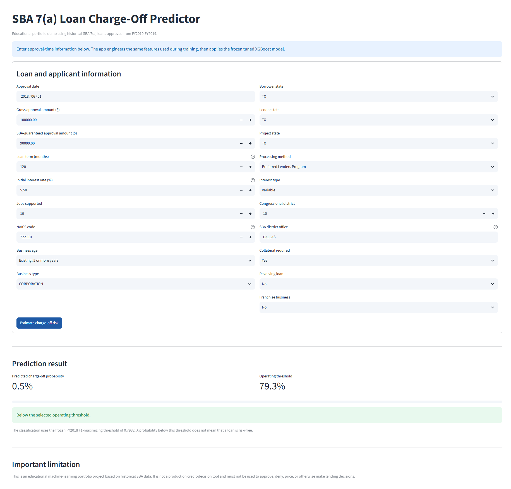

# SBA 7(a) Loan Charge-Off Prediction

A binary-classification project that predicts whether an SBA 7(a) loan will be charged off, using the SBA FOIA 7(a) loan-data release for fiscal years 2010-2019.

The project combines exploratory notebooks with a tested, reusable Python pipeline for cleaning data, engineering features, training the selected model, and evaluating it on a chronologically held-out test set.

## Results

The final tuned XGBoost pipeline was trained on FY2010-FY2017. Its decision threshold was selected on FY2018 by maximizing F1, then locked before one final evaluation on FY2019.

The current model excludes the secondary-market indicator (`SoldSecMrktInd`), because a loan's guaranteed portion is sold on the secondary market *after* approval. The previous model's results are kept for comparison. The hyperparameters are unchanged, so this is a one-feature ablation.

| Model | FY2018 PR-AUC | Threshold | FY2019 PR-AUC | ROC-AUC | Precision | Recall | F1 | Brier score |
| --- | ---: | ---: | ---: | ---: | ---: | ---: | ---: | ---: |
| **Current: without secondary-market flag** | **0.8216** | **0.7932** | **0.7667** | **0.9449** | **0.7516** | **0.6820** | **0.7151** | **0.0522** |
| Previous: with secondary-market flag | 0.8257 | 0.7482 | 0.7750 | 0.9460 | 0.7389 | 0.7082 | 0.7232 | 0.0518 |

See [the current test metrics](reports/fy2019_test_metrics_no_secmkt.csv), [the previous test metrics](reports/fy2019_test_metrics.csv), and [the FY2018 calibration curve](reports/fy2018_calibration_curve_no_secmkt.png). The [grouped feature importance](reports/fy2019_grouped_feature_importance.csv) comes from the previous model.

## Dataset

- Source: SBA FOIA 7(a) loan-data release
- Period: FY2010-FY2019
- Raw records: 545,751
- Modeling sample: 428,874 loans with clear final outcomes
- Target: `0` for paid in full (`P I F`) and `1` for charged off (`CHGOFF`)
- Overall charge-off rate: 7.96%

Raw data is excluded from Git. Place the SBA CSV here:

```text
data/raw/FOIA_7a_FY2010_FY2019_asof_260630.csv
```

The [SBA data dictionary](docs/7a_504_foia_data_dictionary.xlsx) is included for reference.

## Methodology

### Leakage-aware cleaning

Only clear final outcomes (`P I F` and `CHGOFF`) are retained. Outcome-revealing fields such as payment and charge-off dates, charge-off amount, and as-of date are removed, along with the post-approval secondary-market indicator and identity, address, and other high-cardinality fields.

Zero initial interest rates and zero loan terms are treated as missing values. Other missing values are preserved and imputed inside the model pipeline using training data only.

### Features

The model uses 22 features meant to describe the loan as it looked at approval:

- **Numeric:** approval fiscal year, initial interest rate, jobs supported, SBA guarantee ratio, franchise flag, log gross approval, log SBA-guaranteed approval, term in years, and a flag for whether the lender and borrower are in the same state.
- **Categorical:** lender (bank) state, processing method, fixed or variable rate, project state, SBA district office, congressional district, business type, revolver status, collateral indicator, NAICS sector, approval month, guarantee-ratio bucket, and business-age group.

The secondary-market indicator is excluded on purpose (see Limitations). A field-by-field check against the SBA data dictionary found that the timing of `BankState`, and therefore of `same_state_lender`, is uncertain. The dictionary describes the bank as the one the loan is *currently* assigned to. `TermInMonths` gives no timing at all, so it could reflect later loan modifications.

### Temporal evaluation

| Split | Approval years | Purpose |
| --- | --- | --- |
| Training | FY2010-FY2017 | Fit preprocessing and models |
| Validation | FY2018 | Compare models, tune XGBoost, and select threshold |
| Test | FY2019 | One final untouched evaluation |

PR-AUC is the primary model-selection metric because charge-offs are the minority class. The selected XGBoost configuration was tuned with expanding temporal cross-validation within the training period: train FY2010-FY2014 and validate on FY2015, then FY2010-FY2015 on FY2016, then FY2010-FY2016 on FY2017, scored by mean PR-AUC (average precision). The current model's FY2018 F1-maximizing threshold is `0.7932`. It was `0.7482` for the previous model.

Charge-off rates differ by split: 7.55% in training, 10.13% in FY2018 validation, and 9.67% in FY2019 test.

## Validation model comparison

| Model | PR-AUC | ROC-AUC | F1 at 0.50 | Brier score |
| --- | ---: | ---: | ---: | ---: |
| Dummy classifier | 0.1013 | 0.5000 | 0.0000 | 0.1013 |
| Logistic regression | 0.5864 | 0.8777 | 0.5354 | 0.0616 |
| Logistic regression, balanced classes | 0.4900 | 0.8538 | 0.3187 | 0.2405 |
| Random forest | 0.7819 | 0.9406 | 0.7416 | 0.0483 |
| Initial XGBoost | 0.8227 | 0.9671 | 0.7072 | 0.0615 |
| Tuned XGBoost | **0.8257** | **0.9671** | **0.7547** | **0.0445** |
| Tuned XGBoost, no secondary-market flag (current) | 0.8216 | 0.9660 | 0.7421 | 0.0454 |

All rows except the last were produced with the secondary-market indicator included. The last row uses the same tuned hyperparameters without that feature.

## Repository structure

```text
data/
  raw/                 Local SBA source data, excluded from Git
  processed/           Cleaned and feature datasets, excluded from Git
docs/                  SBA data dictionary
  images/              README assets
models/                Frozen tuned-model artifact used by the demo
notebooks/             EDA, cleaning, modeling, tuning, and interpretation
reports/               Final metrics, feature importance, and figures
.streamlit/            Streamlit Community Cloud theme configuration
app/                   Interactive Streamlit prediction interface
src/
  data/                Cleaning functions and dataset CLI
  features/            Feature engineering and preprocessing
  models/              Splitting, training, evaluation, and final-workflow CLIs
tests/                 Automated unit tests
```

## Setup

```powershell
git clone https://github.com/ArsPoghosyan/sba-loan-default.git
cd sba-loan-default

python -m venv .venv
.\.venv\Scripts\Activate.ps1
pip install -r requirements.txt
```

## Reproduce the pipeline

Run these commands from the repository root after placing the raw dataset in `data/raw/`.

```powershell
# 1. Clean the raw FOIA release.
.\.venv\Scripts\python.exe -m src.data.make_dataset `
    --input-path data/raw/FOIA_7a_FY2010_FY2019_asof_260630.csv `
    --output-path data/processed/sba_7a_cleaned_no_secmkt.csv

# 2. Create model-ready features.
.\.venv\Scripts\python.exe -m src.features.make_features `
    --input-path data/processed/sba_7a_cleaned_no_secmkt.csv `
    --output-path data/processed/sba_7a_features_no_secmkt.csv

# 3. Train on FY2010-FY2017 and choose the threshold on FY2018.
.\.venv\Scripts\python.exe -m src.models.train_final `
    --input-path data/processed/sba_7a_features_no_secmkt.csv `
    --model-path models/tuned_xgboost_pipeline_no_secmkt.joblib

# 4. Evaluate the frozen artifact once on FY2019.
.\.venv\Scripts\python.exe -m src.models.evaluate_final `
    --input-path data/processed/sba_7a_features_no_secmkt.csv `
    --model-path models/tuned_xgboost_pipeline_no_secmkt.joblib `
    --metrics-path reports/fy2019_test_metrics_no_secmkt.csv
```

The previous artifact (`models/tuned_xgboost_pipeline.joblib`) and its metrics (`reports/fy2019_test_metrics.csv`) are kept for comparison. The current code can no longer recreate them, because it no longer builds the secondary-market feature.

The notebooks remain the exploratory record of the project. The `src/` pipeline is the reproducible implementation of the final decisions.

## Streamlit demo

The repository includes an interactive single-loan demo in `app/app.py`. It accepts raw approval-time inputs, engineers the same features used during training, and applies the frozen tuned XGBoost artifact.

[](https://sba-loan-default-predictor.streamlit.app/)

Live demo: [sba-loan-default-predictor.streamlit.app](https://sba-loan-default-predictor.streamlit.app/)



*Streamlit interface using approval-time loan information and the frozen tuned XGBoost pipeline.*

Run it locally from the repository root:

```powershell
.\.venv\Scripts\python.exe -m streamlit run app/app.py
```

The interface is an educational portfolio demonstration based on historical SBA data. It is not a production credit-decision tool.

## Tests

Run the complete test suite with:

```powershell
.\.venv\Scripts\python.exe -m pytest tests
```

The current suite contains 36 tests covering cleaning rules, feature engineering, temporal splitting, preprocessing, model configuration, metric calculation, threshold selection, artifact feature-schema validation, inference feature building, and prediction utilities.

## Limitations

- The data contains loans with final observed statuses only. More recent loans may have had less time to resolve, creating outcome-observation bias.
- The F1-maximizing threshold is a practical choice because lender-specific error costs and review-capacity constraints are unavailable. A production threshold should reflect the lender's risk and operating costs.
- Aggregated split importance can favor categorical feature families with many one-hot levels. It should be interpreted alongside the SHAP analysis, not as a causal ranking.
- The model uses `scale_pos_weight=5.0`, so its predicted probabilities overstate risk. On FY2018 the mean predicted probability is 15.9%, against an observed charge-off rate of 10.1%. Treat outputs as risk scores, not literal probabilities, unless the model is recalibrated.
- Some features have uncertain timing. The dictionary describes `BankState` as the bank the loan is *currently* assigned to, and `TermInMonths` may reflect later modifications. `ApprovalFY` is a numeric feature, so the trees treat FY2018 and FY2019 like the latest training year.
- Removed the secondary-market indicator because it is post-approval information; PR-AUC changed from 0.7750 to 0.7667 (FY2019 test; FY2018 validation PR-AUC changed from 0.8257 to 0.8216).
- This project analyzes historical SBA data and is not a production credit-decision system.

## License

This project is licensed under the [MIT License](LICENSE).
